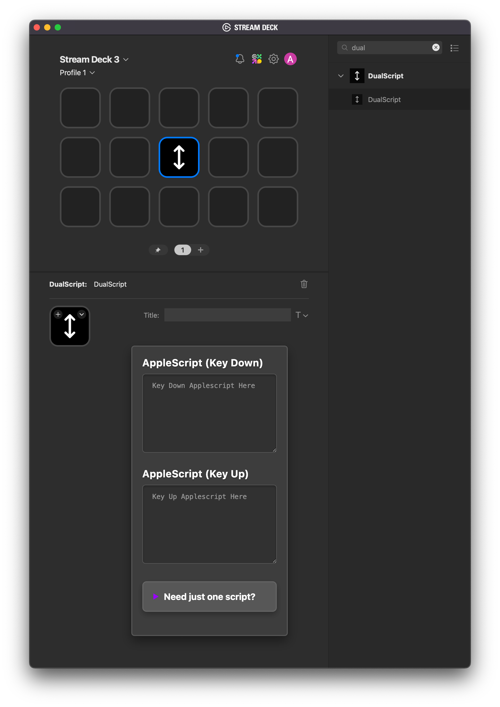

# DualScript



## Description

`DualScript` is a macOS Stream Deck plugin that lets one action run different scripts on key down and key up. It supports AppleScript and JavaScript for Automation (JXA), and it keeps legacy single-script buttons working by migrating their script into the key-down slot.

## Features

- separate key-down and key-up scripts
- AppleScript and JXA execution through OSAKit
- property inspector with language selection, inline editors, and test buttons
- one-command packaging into a `.streamDeckPlugin` installer
- legacy migration from the original single-script action

## Installation

Build or rebuild the installer with:

```bash
./scripts/package.sh
```

The generated installer is:

```text
Release/com.apresley.DualScript.streamDeckPlugin
```

Double-click that file to install it in Stream Deck.

If you want the script to open the installer as soon as it finishes:

```bash
./scripts/package.sh --install
```

## Source code

The Objective-C plugin code lives under `Sources/`, and the Stream Deck bundle assets live under `Sources/com.apresley.DualScript.sdPlugin/`.

## Development

Build and validate the package in one step:

```bash
./scripts/test.sh
```

Useful options:

```bash
./scripts/package.sh --debug
./scripts/package.sh --release
```

## Examples

### Key Down: Open VS Code

```JavaScript
var code = Application('Visual Studio Code');
code.activate();
```

### Key Up: Pause Music

```AppleScript
tell application "Music" to pause
```

## Resources to learn AppleScript and JXA

- [JXA-Cookbook](https://github.com/JXA-Cookbook/JXA-Cookbook)
- [Automating macOS with JXA presentation](https://github.com/josh-/automating-macOS-with-JXA-presentation)
- [Stackoverflow JXA](https://stackoverflow.com/questions/tagged/javascript-automation)
- [Stackoverflow AppleScript](https://stackoverflow.com/questions/tagged/applescript)
